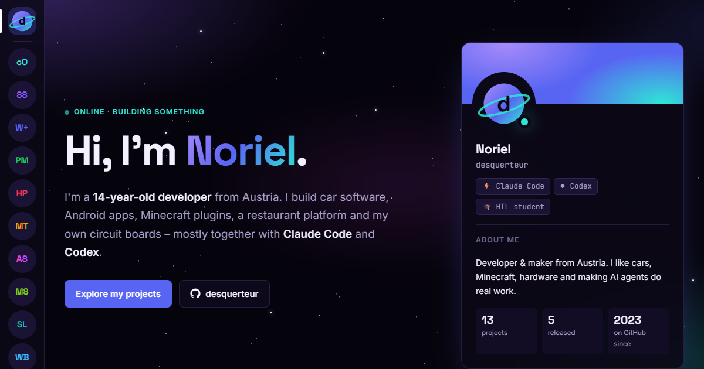

# desquerteur.com

My personal website: who I am and everything I build. Every project gets its own page,
served on its own subdomain – `coscaros.desquerteur.com`, `warden-plus.desquerteur.com`, …
– and every project page links back to the main page.

**Preview:** https://desquerteur.github.io/ (GitHub Pages, path mode: `/projects/<slug>/`)
**Production:** https://desquerteur.com (Cloudflare, subdomain mode)



Design: Discord look on a galaxy background – purple, turquoise and black. Every colour,
font and spacing is documented in [`style.md`](style.md).

## Stack

- [Astro](https://astro.build) – static pages, zero JS except two tiny scripts
- Self-hosted fonts via Fontsource (Space Grotesk, Inter, JetBrains Mono)
- Cloudflare Worker with static assets for the subdomain routing (`worker/index.js`)
- GitHub Actions → GitHub Pages for the preview (`.github/workflows/pages.yml`)
- Videos rendered in code: HTML scene + Playwright + ffmpeg (`video/`)

## Add a project

Everything comes from one file: [`src/data/projects.ts`](src/data/projects.ts).
Add an entry (slug, name, mark, colour, texts, stack, screenshots in
`public/projects/<slug>/`) and the project appears

- as a card on the home page (when `featured: true`),
- in the project file (`/projects/`),
- on its own page → `https://<slug>.desquerteur.com`.

## Develop

```sh
npm install
npm run dev              # http://localhost:4321
npm run build            # path mode (GitHub Pages preview)
npm run build:subdomain  # production mode for desquerteur.com
```

## Go live on desquerteur.com

1. Buy `desquerteur.com` and add it to Cloudflare (free plan), so Cloudflare runs its DNS.
2. In DNS add a proxied wildcard record: `*` → `AAAA 100::` (orange cloud on).
3. Deploy:

   ```sh
   npm run build:subdomain
   npx wrangler login
   npx wrangler deploy
   ```

   `wrangler.jsonc` attaches the Worker to `desquerteur.com`, `www.desquerteur.com` and
   `*.desquerteur.com/*`. The Worker answers `<slug>.desquerteur.com/` with
   `/projects/<slug>/`, redirects `desquerteur.com/projects/<slug>/` to the subdomain and
   sends `www` to the apex.

## Videos

`video/` holds the code that renders the site and project videos (deterministic HTML
scenes captured frame by frame). See [`video/README.md`](video/README.md).
Rendered files are in `public/videos/` and play on the site.

## License

Code: MIT. Project screenshots and videos belong to their projects.
